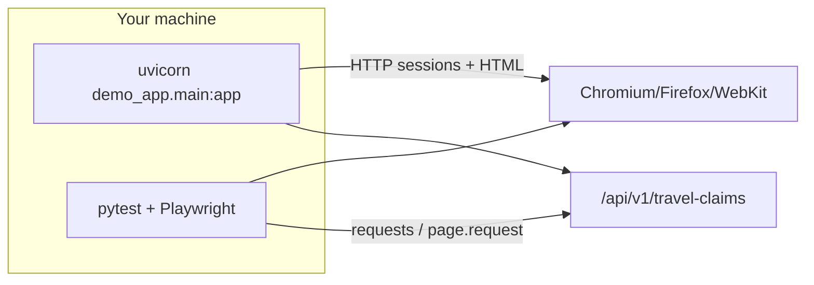

# TravelClaim QA Suite

**Repository:** [github.com/marslan54/travelclaim-qa-suite](https://github.com/marslan54/travelclaim-qa-suite)

Portfolio-style test automation for a **multi-language, multi-step travel compensation** flow (EU261-style claim reasons, corporate login, bilingual operations). The repo includes:

- A **local demo web app** (`demo_app/`) you run with Uvicorn, with no external SaaS accounts.
- An installable framework package (`travelclaim_qa/`): **Page Object Models**, synthetic test data and a **pytest plugin** with shared fixtures, versioned and installable with pip.
- **Playwright + pytest** UI suites with **markers**, a saved login reused across tests, and screenshots and traces on failure.
- An **REST contract layer** (`tests/api/`) using **requests** and **Playwright’s `request` API**.
- **GitHub Actions** on every pull request and push to `main`: ruff lint, then tests in parallel per browser (**Chromium, Firefox, WebKit**), with Allure, JUnit and failure artifacts.

---

## Installation guide

Follow these steps on a fresh machine (Windows PowerShell examples; adapt paths for macOS/Linux).

### 1. Prerequisites

| Requirement | Notes |
| --- | --- |
| **Python** | **3.10+** supported; **3.11+ or 3.12** recommended (CI uses **3.12**). Verify: `python --version` |
| **Git** | To clone this repository |

### 2. Clone and enter the project

```powershell
git clone https://github.com/marslan54/travelclaim-qa-suite.git
cd travelclaim-qa-suite
```

### 3. Virtual environment (recommended)

```powershell
python -m venv .venv
.\.venv\Scripts\Activate.ps1
python -m pip install --upgrade pip
```

On macOS/Linux:

```bash
python3 -m venv .venv
source .venv/bin/activate
pip install --upgrade pip
```

### 4. Install Python dependencies

From the repository root (the folder that contains `requirements.txt`, `demo_app/`, `tests/`):

```powershell
pip install -r requirements.txt   # installs the package (editable) with pinned tooling
pre-commit install                # optional: ruff lint and format on every commit
```

### 5. Install Playwright browser binaries

Browsers are **not** bundled in `requirements.txt`; install them separately:

```powershell
python -m playwright install chromium firefox webkit
```

For CI-style system deps on Linux only, `--with-deps` is used (see `.github/workflows/travelclaim-qa-ci.yml`). On Windows/Mac, the command above is usually enough.

---

## What this suite covers

| Layer | Folder | Scope |
| --- | --- | --- |
| **Smoke** | `tests/smoke/` | `/health`, login chrome, authenticated wizard shell |
| **UI functional** | `tests/ui/` | Happy-path submission, validation errors, bad login, locales (`en`/`de`/`fr`) |
| **UI edge** | `tests/ui/` | Unicode names, long strings within HTML limits, browser back/forward |
| **Regression** | `tests/regression/` | Alternate itinerary profile through confirmation |
| **API** | `tests/api/` | `POST /api/v1/travel-claims`: **201** + JSON schema; **422** validation; simulated **400/500** |

The demo app exposes:

- Multilingual routes: **`/{locale}/login`**, **`/{locale}/claim/step1`** to **`step3`**, **`/{locale}/claim/confirmation`** with `locale ∈ { en, de, fr }`.
- REST: **`GET /health`**, **`GET /api/v1/config/locales`**, **`POST /api/v1/travel-claims`** (`201 Created` on success).

---

## How it works

1. **`demo_app/main.py`** hosts the portal and API. Login state and wizard progress live in a signed session cookie, which makes “resume claim” flows testable.
2. **Tests** assume the portal is reachable at **`http://127.0.0.1:8765`** (see `base_url` in **`pyproject.toml`**, or override with **`TRAVELCLAIM_BASE_URL`**).
3. The package's pytest plugin (**`travelclaim_qa/plugin.py`**) runs **`verify_portal`** once per session against **`GET /health`**. If the server is down, pytest exits with a clear instruction instead of long Playwright timeouts.
4. **`travelclaim_qa/pages/`** centralize selectors (`data-testid`) and navigation; **`travelclaim_qa/data.py`** feeds synthetic payloads.
5. Authenticated tests don't log in through the UI each time: the plugin logs in once per session (once per worker in parallel runs), saves the session, and **`conftest.py`** starts those tests from it.
6. **Playwright** drives browsers; **`pytest-base-url`** supplies the `base_url` fixture, and **`TRAVELCLAIM_BASE_URL`** overrides it when set.



---

## Running everything locally

You need **two terminals** (or one terminal for the server and one for tests).

### Terminal A: start the demo portal

```powershell
cd <path-to-repo>
.\.venv\Scripts\Activate.ps1   # if using a venv
python -m uvicorn demo_app.main:app --host 127.0.0.1 --port 8765
```

Wait until you see **“Uvicorn running on http://127.0.0.1:8765”**.

**Default login** (overridable with `TC_DEMO_EMAIL` / `TC_DEMO_PASSWORD`):

- Email: `claims.analyst@travelclaim.example`
- Password: `Eu261_R3gress!`

### Terminal B: run the full test pack

```powershell
cd <path-to-repo>
.\.venv\Scripts\Activate.ps1
python -m pytest -n auto --browser chromium
```

`-n auto` runs tests in parallel across CPU cores (pytest-xdist). Failed UI tests leave a screenshot and a Playwright trace in `test-results/`; open a trace with `playwright show-trace <file>.zip`.

**Expected:** all tests **pass** (currently **21** UI + API cases for one browser run).

### Cross-browser (full matrix locally)

```powershell
python -m pytest tests `
  --browser chromium `
  --browser firefox `
  --browser webkit
```

### Optional: Allure raw results

```powershell
python -m pytest tests --browser chromium --alluredir=reports/allure/local-run
```

Serve with the Allure CLI: `allure serve reports/allure/local-run` (install [Allure](https://github.com/allure-framework/allure2) separately).

### Targeted runs

```powershell
python -m pytest tests/smoke --browser chromium
python -m pytest tests/ui --browser chromium
python -m pytest tests/api
python -m pytest -m smoke --browser chromium
```

---

## Configuration

| Variable | Purpose |
| --- | --- |
| **`TRAVELCLAIM_BASE_URL`** | Base URL for the demo app if not using `http://127.0.0.1:8765` |
| **`TC_DEMO_EMAIL`** / **`TC_DEMO_PASSWORD`** | Credentials the demo app expects for login (demo-only defaults, never real accounts) |

---

## Troubleshooting

| Problem | What to do |
| --- | --- |
| **`TravelClaim demo portal not reachable`** (pytest exits immediately) | Start Uvicorn (Terminal A) or fix `TRAVELCLAIM_BASE_URL`. |
| **Port `8765` already in use (WinError 10048)** | Find the PID: `netstat -ano \| findstr :8765` → `Stop-Process -Id <PID> -Force`, or run Uvicorn on another port **and** set `TRAVELCLAIM_BASE_URL`. |
| **Playwright browser missing** | Run `python -m playwright install chromium` (add `firefox`, `webkit` as needed). |
| **`requests` dependency warning** (urllib3/chardet) | Harmless on many setups; pin compatible versions only if your org requires a clean warnings gate. |

---

## Project layout

```
demo_app/            # FastAPI multilingual UI + mocked REST submissions
travelclaim_qa/      # The installable framework package
  pages/             # Page Object Models (login, wizard steps, confirmation)
  auth.py            # Demo credentials (env-overridable)
  data.py            # Synthetic test data factories
  plugin.py          # pytest plugin: base URL override, health gate, saved login
reports/allure/      # Git keeps .gitkeep; Allure results written at runtime
tests/
  api/               # REST contract + fault injection
  regression/        # Deeper journeys
  smoke/             # Fast checks
  ui/                # Functional, i18n, edge cases
conftest.py          # Starts authenticated tests from the saved login
pyproject.toml       # Package metadata, pytest settings, ruff rules
requirements.txt     # Pinned versions for CI and local runs
.pre-commit-config.yaml  # ruff + basic hygiene hooks
.github/workflows/   # CI: matrix browsers, Allure + JUnit artifacts
```

---

## CI/CD

`.github/workflows/travelclaim-qa-ci.yml` runs on **every pull request** and **push to `main`**. A ruff job lints and checks formatting first; then one job per browser installs the package, starts **`uvicorn`**, runs **`pytest -n auto`** in parallel and uploads Allure results and JUnit XML, plus screenshots and traces when a test fails. With branch protection on `main`, a red run blocks the merge.

## Using the framework in another project

```bash
pip install "travelclaim-qa @ git+https://github.com/marslan54/travelclaim-qa-suite@v1.0.0"
```

The page objects and data factories import from `travelclaim_qa`, and the plugin's fixtures (`verify_portal`, `auth_storage_state`) register with pytest automatically. Releases are versioned in `travelclaim_qa/__init__.py` and tagged.

---

## Tech choices (short)

| Choice | Why |
| --- | --- |
| **Playwright + pytest** | Industry-standard stack; solid waiting, traces, multi-browser. |
| **Page objects + `data-testid`** | Stable selectors without coupling to cosmetics. |
| **FastAPI demo** | Lightweight, typed API, multilingual templates, a realistic QA target. |
| **Allure** | Rich stakeholder reports from the same pytest run. |

---

## Last verification run

CI runs the full suite on Chromium, Firefox and WebKit for every pull request; see the Actions tab for the latest results.

---

## Optional next steps for reviewers

- Wire **HTML Allure Trend** storage in CI after the first nightly runs.
